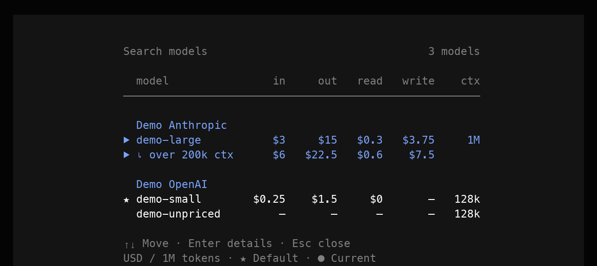
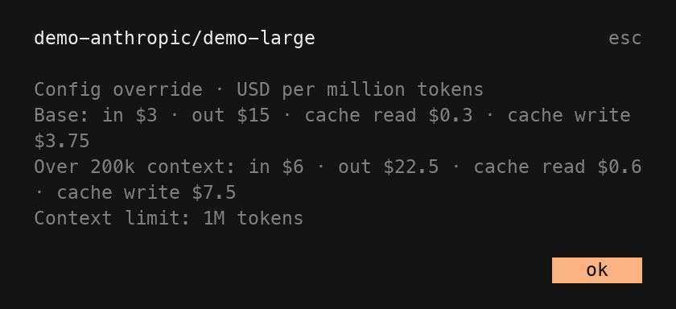
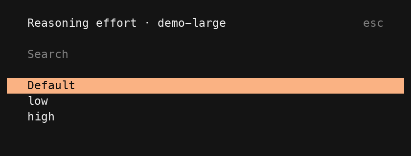
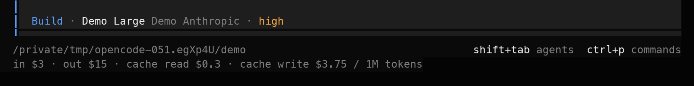

# OpenCode Model Costs

Compare input, output, and cache prices across models without leaving the [OpenCode](https://opencode.ai) terminal. Prices are in **USD per million tokens**. Open `/models-cost` to browse rates before choosing a model.



The screenshot uses the repository’s synthetic pricing fixture.

## Install from npm

This plugin targets **OpenCode 2.3.2**. Run this command to install it and add it to your global OpenCode config. [OpenCode plugin commands](https://opencode.ai/docs/cli/commands/#plugin)

```sh
opencode plugin add opencode-model-costs
```

Start or restart OpenCode and run `/models-cost`.

### Install for one project

Add `opencode-model-costs` to the `plugins` array in the project’s `opencode.json` or `opencode.jsonc`.

```json
{
  "plugins": ["opencode-model-costs"]
}
```

OpenCode installs the plugin from npm when it loads the configuration. To pin a release, use `opencode-model-costs@0.5.3` in the `plugins` array or as the argument to `opencode plugin add`. [OpenCode plugin configuration](https://opencode.ai/docs/build/plugins/#load)

## Browse and switch models

- Type to filter by model or provider. Use **↑** and **↓** to move and **Enter** to inspect prices. **Esc** clears the search, then closes the table.
- The wide view groups models by provider and shows cache prices and context tiers inline. Narrow terminals use OpenCode’s native picker.
- In a session, choose **Switch to this model** or **Choose reasoning effort** if the model has variants. Pick **Default** or a named variant to apply the model and effort together. Esc cancels the picker and keeps the current selection. Switching applies to the current session and leaves config files untouched.
- On the home screen, the same action selects the model and effort for your first prompt.





## Configure the footer

By default, the footer shows the current model’s base rates on a separate row below the prompt status line. It includes cache read and write when pricing is available and the line fits. On narrow terminals it shows input and output only. To hide it on OpenCode 2.3.2, set `footer: false` on the plugin entry in your terminal client’s `cli.json` (typically `~/.config/opencode/cli.json`). Use the same package reference as in your `opencode.json(c)`.



```json
{
  "plugins": [
    {
      "package": "opencode-model-costs",
      "options": { "footer": false }
    }
  ]
}
```

For a one-off run, pass this JSON via `OPENCODE_CLI_CONFIG_CONTENT`. [OpenCode CLI settings](https://opencode.ai/docs/cli/config/#plugins)

## Where prices come from

The plugin reads configuration declarations and model prices through the OpenCode client. When you declare a provider in `opencode.json(c)`, the browser lists only the models declared in config. With no provider declarations, it lists the configured catalog instead.

Model details identify configured overrides and catalog rates. **`$0`** means the source reported zero. **`—`** means a rate was unavailable. The plugin displays rates, while OpenCode tracks session spend separately.

Here is a model cost override for an existing provider model:

```json
{
  "providers": {
    "anthropic": {
      "models": {
        "claude-sonnet-4": {
          "cost": {
            "input": 3,
            "output": 15,
            "cache": { "read": 0.3, "write": 3.75 }
          }
        }
      }
    }
  }
}
```

Use an array of cost entries for tiered pricing. A context tier adds `"tier": { "type": "context", "size": 200000 }` to the entry that applies above that threshold. See the [demo config](opencode.json) for a complete example. Legacy `provider` declarations and V1-shaped cost fields are also recognized by the V2 plugin.

## Contribute

To run from source, clone this repository and run `npm ci` with Node.js 26.4.0 or later. Run `opencode --standalone` in the checkout to try the included demo config with synthetic rates. To use the checkout in another project, add its absolute path to that project’s `plugins` array.

See [CONTRIBUTING.md](CONTRIBUTING.md) for hands-on verification steps. The [changelog](CHANGELOG.md) records releases.

Released under the [MIT License](LICENSE).
